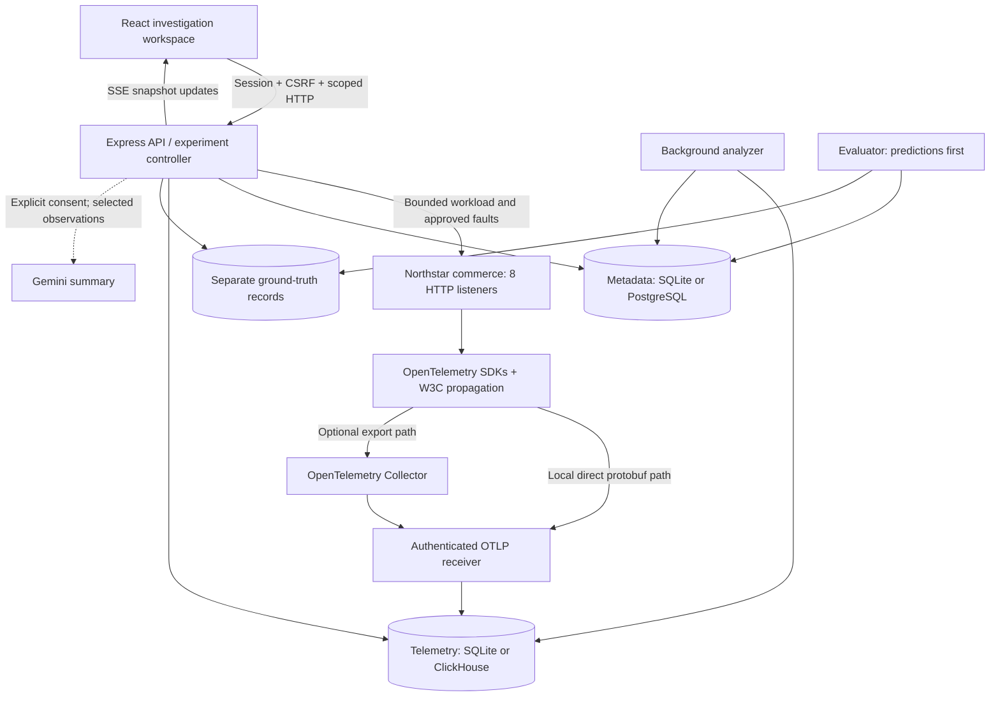
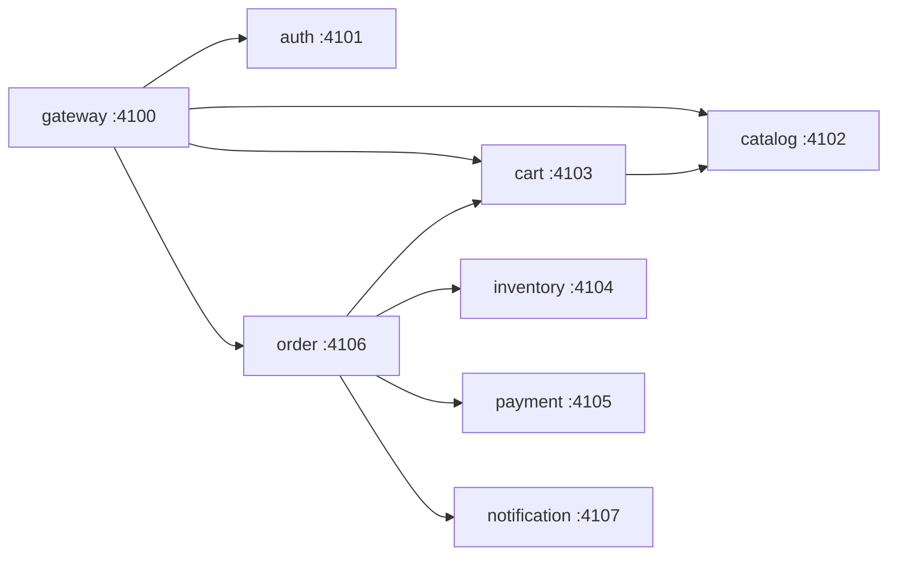
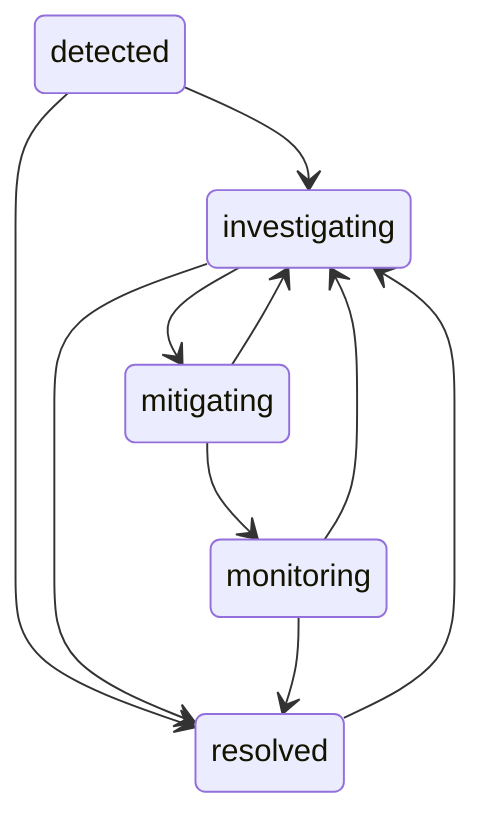

# CausalScope

**From symptoms to evidence.**

A distributed incident investigation platform that captures OpenTelemetry traces, reconstructs service dependencies, detects anomalous behavior, and ranks possible explanations with inspectable evidence.

CausalScope includes a working synthetic commerce system, a failure laboratory, paired healthy/fault experiments, incident workflows, historical replay, and optional Gemini summaries. The local experience uses captured requests and persisted telemetry; seeding does not install prerecorded traces.

> **Status:** Functional engineering edition. Local SQLite, real HTTP service traffic, OTLP protobuf ingestion, analysis, API security, and browser workflows have verification evidence. PostgreSQL/ClickHouse and Docker configurations are implemented but still require runtime acceptance on that stack. Rankings express hypotheses and uncertainty, not proven production causes.

## Contents

- [Capabilities](#capabilities)
- [Technology stack](#technology-stack)
- [Architecture](#architecture)
- [How an investigation works](#how-an-investigation-works)
- [Analysis and algorithms](#analysis-and-algorithms)
- [Project structure](#project-structure)
- [Getting started](#getting-started)
- [Configuration](#configuration)
- [Failure laboratory](#failure-laboratory)
- [Frontend routes](#frontend-routes)
- [API reference](#api-reference)
- [Telemetry and internal routes](#telemetry-and-internal-routes)
- [Gemini summaries](#gemini-summaries)
- [Security and permissions](#security-and-permissions)
- [Development and verification](#development-and-verification)
- [Deployment](#deployment)
- [Troubleshooting](#troubleshooting)
- [Current boundaries](#current-boundaries)
- [Documentation](#documentation)

## Capabilities

A slow checkout can involve retries, dependency waits, queue backlog, and incomplete telemetry. CausalScope connects those observations so an investigator can follow a ranked explanation back to the recorded requests and compare it with a controlled experiment.

| Capability         | Implementation                                                                                                             |
| ------------------ | -------------------------------------------------------------------------------------------------------------------------- |
| Captured telemetry | Genuine OpenTelemetry server/client/internal spans, W3C context propagation, events, links, and correlated logs.           |
| Service topology   | Observed call edges, upstream/downstream neighborhoods, strongly connected components, condensation graphs, bounded paths. |
| Trace inspection   | Trace search, real span positions, waterfall zoom/pan, parent collapse, keyboard selection, quality warnings.              |
| Derived metrics    | Five-second windows for latency, throughput, errors, retries, waits, queue behavior, and trace references.                 |
| Anomaly detection  | Median/MAD with sample and relative-deviation gates; EWMA/CUSUM corroboration.                                             |
| Ranked hypotheses  | Inspectable graph/evidence factors, contradictory evidence, metric-only baseline, and unknown/outside-system candidate.    |
| Incident workflow  | Persisted incidents, validated status transitions, notes, analysis snapshots, JSON/Markdown reports.                       |
| Historical replay  | Stored metric/dependency windows and anomaly references.                                                                   |
| Failure laboratory | Ten bounded fault mechanisms across eight real HTTP listeners.                                                             |
| Paired experiments | Matching workload/seed/rate healthy and fault execution; predictions saved before evaluation labels are read.              |
| Live updates       | Session-authenticated SSE snapshots that invalidate cached HTTP queries.                                                   |
| Optional AI        | Consent-gated observation summaries with checked evidence IDs.                                                             |

## Technology stack

| Layer                 | Technologies                                                                                       |
| --------------------- | -------------------------------------------------------------------------------------------------- |
| Language / workspace  | TypeScript, Node.js 24+, ESM, pnpm workspaces                                                      |
| Frontend              | React 19, Vite 8, React Router 7, TanStack Query 5                                                 |
| Visuals               | Custom SVG graphs/waterfalls/charts, CSS, Motion, Lucide                                           |
| API / authentication  | Express 5, Zod, Argon2id, opaque sessions, CSRF, role/scope guards, Helmet                         |
| Instrumentation       | OpenTelemetry API/SDK, AsyncLocalStorage context, W3C trace context, protobuf OTLP/HTTP exporter   |
| Ingestion             | Express raw protobuf receiver, protobufjs, vendored OpenTelemetry proto v1.9.0                     |
| Collector             | Optional OpenTelemetry Collector Contrib 0.163.1                                                   |
| Local persistence     | Node built-in SQLite, WAL, parameterized statements                                                |
| Full persistence      | PostgreSQL + Prisma 6.19.3 for metadata; ClickHouse client and ReplacingMergeTree telemetry tables |
| Logging / optional AI | Pino, Google GenAI JavaScript SDK                                                                  |
| Quality               | Vitest, Supertest, Playwright, TypeScript, Prettier                                                |
| Infrastructure        | Docker Compose, application Dockerfile, ClickHouse SQL, Collector YAML, GitHub Actions             |

See [package.json](package.json) and [pnpm-lock.yaml](pnpm-lock.yaml) for exact declared and resolved versions. Prisma 6 is deliberately pinned in this project.

## Architecture



### Runtime components

| Component                  | Responsibility                                                                                                 |
| -------------------------- | -------------------------------------------------------------------------------------------------------------- |
| `apps/web`                 | Landing/login, investigation screens, SVG visualizations, cached queries, SSE subscription.                    |
| `apps/api`                 | Sessions, scope/role checks, evidence queries, incidents, experiments, comparisons, exports, optional AI.      |
| `apps/ingest`              | Bounded authenticated OTLP protobuf and correlated-log ingestion; persist before acknowledgement.              |
| `apps/analyzer`            | Analyze a bounded five-minute window every five seconds, persist results, prune raw local telemetry.           |
| `apps/demo-system`         | Eight individually addressed HTTP services in one Node process, with bounded pools/queues and expiring faults. |
| `packages/instrumentation` | Per-service SDK providers, context propagation, server/client/internal spans, correlated logs.                 |
| `packages/telemetry`       | Official-schema protobuf decoding, validation, redaction, export responses.                                    |
| `packages/analysis`        | Graph reconstruction, temporal/quality checks, aggregation, anomaly detection, hypothesis ranking.             |
| `packages/storage`         | Tenant-scoped metadata/telemetry abstraction over local or full persistence.                                   |
| `packages/shared`          | Domain contracts, experiment validation, configuration, logging.                                               |

### Persistence modes

| Concern                 | Local mode                        | Full mode                                                         |
| ----------------------- | --------------------------------- | ----------------------------------------------------------------- |
| Selection               | `STORAGE_MODE=local`              | `STORAGE_MODE=production`                                         |
| Metadata                | SQLite records                    | PostgreSQL JSONB records through Prisma                           |
| Traces and logs         | SQLite                            | ClickHouse                                                        |
| Fault labels            | Separate local ground-truth table | Separate metadata records                                         |
| Raw telemetry retention | `RETENTION_DAYS` pruning          | ClickHouse TTL in supplied SQL; currently seven days              |
| Infrastructure          | Node process plus local files     | PostgreSQL, ClickHouse, application processes; optional Collector |
| Verification            | Runtime-verified local adapter    | Implemented/prepared; full-stack runtime acceptance outstanding   |

Local files live in `.data/causalscope.sqlite` by default. Metadata keys include workspace/kind/id; span identity includes workspace/environment/trace/span. Metadata uses compact document records rather than a fully normalized domain schema.

Repeated exports do not multiply analytical span counts. SQLite retains the first observation; ClickHouse reads use `FINAL` over replacing tables and retain the latest ingested version. Producers should not mutate completed spans. Cross-database operations have no shared ACID transaction, and exporter/Collector buffers are finite and volatile.

### Synthetic service graph



These are eight real HTTP listeners sharing one process and host. They are not eight independently deployed containers. Notification consumer traces use links to enqueue context rather than invented parent relationships.

## How an investigation works

1. **Execute traffic:** the controller starts a bounded browse/cart/checkout workload against approved synthetic service addresses.
2. **Capture observations:** SDKs record server/client/internal spans, events, exceptions, and propagated context, then export protobuf directly or through the Collector.
3. **Validate and persist:** ingestion checks credentials, scope, size, IDs, timestamps, attributes, and quotas before acknowledging storage.
4. **Build evidence:** analysis reconstructs traces and dependencies, computes windows/local time, detects anomalies, and ranks candidate services/failure modes.
5. **Investigate:** inspect topology, traces, correlated logs, hypotheses, and quality warnings. Every supported reference points to stored observations.
6. **Track an incident:** open from an analysis, add notes, change status, inspect historical windows, and export a deterministic report.
7. **Compare:** execute a healthy/fault pair with matching workload settings. Save predictions before reading hidden labels for evaluation.
8. **Optionally summarize:** explicitly consent to sending selected anomaly observations to Gemini; returned evidence IDs are checked.

### First reproducible investigation

1. Open **Failure laboratory** and run **healthy checkout**, seed `42`, `8 req/s`, for `20 seconds`.
2. Run **Database pool exhaustion**, target **inventory**, `400 ms`, with the same seed/rate/workload for `15 seconds`.
3. Open the completed analysis. Inspect pool waits, anomalies, hypotheses, and supporting trace IDs.
4. Follow a trace to its actual server/client spans, local time, exceptions, dependency relationships, and correlated logs.
5. Create an incident, add a note, update status, inspect replay, and export Markdown or JSON.
6. Use **Counterfactual lab** to orchestrate a matching healthy/fault pair; repeat to study variability.

A matching baseline improves interpretation. A leading inventory hypothesis is an observed outcome, not a guaranteed result or proof of a production cause.

## Analysis and algorithms

| Stage                | Method / interpretation                                                                                                     |
| -------------------- | --------------------------------------------------------------------------------------------------------------------------- |
| Graph reconstruction | Observed client/server relationships and service edges; BFS/DFS, reachability, Tarjan SCC, condensation DAG, bounded paths. |
| Trace quality        | Structural span constraints, link associations, missing-parent/skew warnings, interval unions and exclusive local time.     |
| Aggregation          | Exact sorted percentiles and five-second windows; sparse data is handled explicitly.                                        |
| Baseline             | First three eligible windows with at least three observations; matched healthy experiment spans where available.            |
| Detection            | Robust deviation using median/MAD; threshold `3.5` plus relative-deviation gate `0.30`; noise floors for flat/sparse data.  |
| Corroboration        | EWMA (`alpha=0.3`) and one-sided CUSUM support eligible deviation findings.                                                 |
| Ranking              | Deviation, direct waits/errors, local-time share, reachable callers, observed version changes, and missing-data penalties.  |
| Uncertainty          | Contradictory evidence, incomplete capture warnings, and unknown/outside-system candidate.                                  |
| Evaluation           | Actual top-1, top-3, reciprocal-rank, metric-baseline results after predictions.                                            |

Normalized ranking scores are **not calibrated causal probabilities**. The first eligible windows can already contain faults; seasonality, independent causal identification, and general async critical-path calculation are unfinished. See [ALGORITHMS.md](ALGORITHMS.md) for formulas, complexity, and evidence boundaries.

## Project structure

```text
casualScope_cv/
├── apps/
│   ├── api/                    # Session API, incident workflow, experiment controller
│   ├── ingest/                 # Authenticated OTLP protobuf/log receiver
│   ├── analyzer/               # Background worker and analysis orchestration
│   ├── demo-system/            # Eight HTTP listeners, bounded pool/queue, faults
│   └── web/                    # React workspace, visuals, styles, Vite config
├── packages/
│   ├── analysis/               # Graph, statistics, trace and ranking algorithms
│   ├── instrumentation/        # OpenTelemetry SDKs and context propagation
│   ├── telemetry/              # Protobuf transport and validation
│   ├── storage/                # SQLite / PostgreSQL + ClickHouse adapters
│   └── shared/                 # Contracts, configuration, logger
├── prisma/                     # Full-mode metadata schema and SQL migration
├── infrastructure/
│   ├── collector/              # Local and Compose Collector configurations
│   ├── clickhouse/             # Telemetry tables and TTL
│   ├── docker/                 # Application Dockerfile
│   └── proto/                  # Vendored official OpenTelemetry schema/license
├── scripts/                    # Dev launcher, seed, benchmarks, live/pair checks
├── tests/
│   ├── algorithms/             # Graph, statistics and reconstruction checks
│   ├── integration/            # OTLP ingestion checks
│   ├── security/               # API authentication/isolation/validation
│   ├── unit/                   # Bounded-pool behavior
│   └── e2e/                    # Browser workflows and responsive checks
├── docs/                       # API, security, ingestion, deployment, evidence
├── artifacts/                  # Recorded live verification and benchmark outputs
├── .github/workflows/          # Continuous integration
├── .env.example                # Public configuration template
└── docker-compose.yml          # Prepared full-storage stack
```

Runtime `.data`, dependencies, frontend `dist`, and browser reports are ignored artifacts. The product name is **CausalScope**; the local directory name is `casualScope_cv`.

## Getting started

### Local mode: no Docker required

Requirements: **Node.js 24+** and **pnpm 12.11.2**. Run from the repository root:

```powershell
pnpm install --frozen-lockfile
pnpm db:generate
if (-not (Test-Path .env)) { Copy-Item .env.example .env }
pnpm db:seed
pnpm dev
```

The seed creates a local user/workspace, not live telemetry. `pnpm dev` starts the API, receiver, analyzer, commerce listeners, and Vite. It checks required ports before starting and exits on conflicts. Stop with Ctrl+C.

Open [http://localhost:5180/app](http://localhost:5180/app) and sign in:

| Field    | Local synthetic value      |
| -------- | -------------------------- |
| Email    | `engineer@northstar.local` |
| Password | `Northstar-local-2026!`    |

Set `DEMO_EMAIL` / `DEMO_PASSWORD` **before first seed** to change the initial account. Changing them later does not update an existing stored password.

### Ports

| Component                         | Port / address                                                             |
| --------------------------------- | -------------------------------------------------------------------------- |
| Web                               | [http://localhost:5180](http://localhost:5180)                             |
| API                               | [http://localhost:4400/api/v1/health](http://localhost:4400/api/v1/health) |
| OTLP receiver                     | `4319`                                                                     |
| Synthetic services                | `4100`–`4107`                                                              |
| Optional Collector                | `4318`; configured health endpoint `13133`                                 |
| Full-mode PostgreSQL / ClickHouse | `5432` / `8123`                                                            |

The analyzer has no HTTP listener. Local SQLite requires neither PostgreSQL nor ClickHouse. The Vite API proxy targets port 4400; update its configuration if changing the API port.

### Optional native Collector

Default local mode exports genuine SDK protobuf directly to the receiver. To test the Collector path, use [the local Collector configuration](infrastructure/collector/local.yaml):

```powershell
# Terminal 1: use your installed Collector binary.
$env:INGEST_TOKEN = 'YOUR_MATCHING_LOCAL_INGEST_TOKEN'
& 'C:\path\to\otelcol.exe' --config=infrastructure/collector/local.yaml

# Terminal 2: use the same INGEST_TOKEN in .env.
$env:OTEL_EXPORTER_OTLP_ENDPOINT = 'http://127.0.0.1:4318'
pnpm dev
```

Collector 0.163.1 was exercised in earlier local verification. This receiver supports protobuf traces; OTLP logs, metrics, gRPC, and JSON are outside its supported transport.

### Prepared full-storage stack

```powershell
docker compose up --build -d
```

Compose includes PostgreSQL, ClickHouse initialization, migration, Collector, receiver, commerce, analyzer, and API serving the built frontend at [http://localhost:4400](http://localhost:4400). It uses development settings and loopback-published infrastructure ports. Docker/PostgreSQL/ClickHouse acceptance remains outstanding; see [deployment preparation](docs/deployment/README.md).

## Configuration

Use the ignored `.env` for local values and a secret store for deployment. Restart the relevant processes after changes.

| Variable                                  | Purpose / default                                                                                              |
| ----------------------------------------- | -------------------------------------------------------------------------------------------------------------- |
| `NODE_ENV`                                | Development/production behavior; default `development`.                                                        |
| `STORAGE_MODE`                            | `local` SQLite or `production` PostgreSQL/ClickHouse; default `local`.                                         |
| `DATA_DIR`                                | Local SQLite directory; default `.data`.                                                                       |
| `DATABASE_URL`                            | Required connection URL in full storage mode.                                                                  |
| `CLICKHOUSE_URL`                          | Full-mode HTTP endpoint; default `http://localhost:8123`.                                                      |
| `CLICKHOUSE_USER` / `CLICKHOUSE_PASSWORD` | Full-mode ClickHouse credentials.                                                                              |
| `SESSION_SECRET`                          | Production configuration guard requires a non-placeholder value; sessions themselves use random stored tokens. |
| `INGEST_TOKEN`                            | Bearer credential for internal telemetry/log ingestion; match exporters and Collector.                         |
| `CONTROL_TOKEN`                           | Internal synthetic-service/control credential; match API and commerce process.                                 |
| `API_PORT` / `INGEST_PORT`                | Default `4400` / `4319`.                                                                                       |
| `WEB_ORIGIN`                              | Exact browser origin; default `http://localhost:5180`.                                                         |
| `DEMO_HOST`                               | Approved target host: `127.0.0.1` locally or `demo` in Compose.                                                |
| `INGEST_HOST`                             | Internal receiver hostname for direct export/logs; default `127.0.0.1`, `ingest` in Compose.                   |
| `OTEL_EXPORTER_OTLP_ENDPOINT`             | Optional Collector base URL; when empty, SDKs use the direct receiver path.                                    |
| `FAULT_LAB_ENABLED`                       | Enables approved synthetic experiments; default `true`.                                                        |
| `PUBLIC_DEMO`                             | Tighter workload limits: at most 5 req/s and 30 seconds; default `false`.                                      |
| `DEMO_EMAIL` / `DEMO_PASSWORD`            | Initial seeded account; configure before first seed.                                                           |
| `RETENTION_DAYS`                          | Local raw telemetry retention, 1–90 days; default `7`. ClickHouse TTL is configured separately in SQL.         |
| `GEMINI_ENABLED`                          | Optional summaries; default disabled in the example.                                                           |
| `GEMINI_API_KEY`                          | Backend-only Google credential.                                                                                |
| `GEMINI_MODEL`                            | Explicit model ID; template uses `gemini-3.5-flash-lite`.                                                      |
| `SERVE_WEB`                               | `true` serves `dist/web` from the API; production also enables this.                                           |
| `LOG_LEVEL`                               | Pino logging level; default `info`.                                                                            |
| `POSTGRES_PASSWORD`                       | Compose interpolation for the PostgreSQL service.                                                              |

The example also contains `APP_ENCRYPTION_KEY`, `DEMO_MODE`, and `OTEL_SERVICE_NAME`. These are not active runtime controls in the current implementation: no reversible application vault is implemented, lab behavior uses the explicit lab flags, and instrumentation names resources per synthetic service.

Production guards require full storage, HTTPS, non-placeholder credentials, and a unique seed password. The supplied Compose configuration intentionally uses development mode. Do not interpret `STORAGE_MODE=production` alone as a hardened deployment.

## Failure laboratory

Each experiment has validated bounds: **5–90 seconds**, **1–20 req/s**, seed **1–2147483647**, and magnitude **10–1500**. Only approved synthetic service enums/hosts are accepted. One controller workload runs at a time; public-demo mode applies tighter limits.

| Fault ID              | Mechanism / target                                                                                          |
| --------------------- | ----------------------------------------------------------------------------------------------------------- |
| `healthy`             | Baseline traffic without an injected fault.                                                                 |
| `pool-exhaustion`     | Inventory's bounded connection pool capacity drops; captured spans expose pool waits. Requires `inventory`. |
| `cascading-timeout`   | Delays exceed the 900 ms client deadline and propagate failures. Magnitude must be at least 1000 ms.        |
| `retry-storm`         | Payment failures cause bounded order-service retries with recorded attempts. Requires `payment`.            |
| `cache-degradation`   | Catalog cache misses trigger a measured synthetic database-read delay. Requires `catalog`.                  |
| `partial-failure`     | Seeded failures on the selected service.                                                                    |
| `queue-backlog`       | Notification processing lags, exposing queue depth and message age. Requires `notification`.                |
| `latency`             | Added delay on the selected service.                                                                        |
| `bad-deployment`      | Observable version-regression behavior on the selected service.                                             |
| `unavailable`         | Selected service responds as unavailable.                                                                   |
| `resource-saturation` | Contention on a bounded resource rather than unbounded host exhaustion.                                     |

Stopping a run requests a reset; service-side expiry independently removes faults. Restart recovery marks interrupted runs and requests reset. Paired execution uses the same workload/seed/rate and actual healthy/fault spans; missing baselines produce warnings. See [experiment methodology](docs/experiments/README.md).

## Frontend routes

| Route              | Screen / purpose                                                                        |
| ------------------ | --------------------------------------------------------------------------------------- |
| `/`                | Public landing page.                                                                    |
| `/app`             | Authenticated shell; shows login when unauthenticated, otherwise redirects to overview. |
| `/app/overview`    | Operational state, captured evidence, recent incidents.                                 |
| `/app/services`    | Observed service/dependency map and neighborhoods.                                      |
| `/app/traces`      | Trace search and detailed waterfall inspection.                                         |
| `/app/metrics`     | Derived metric windows and anomalies.                                                   |
| `/app/events`      | Structured correlated logs/events.                                                      |
| `/app/incidents`   | Incident creation, details, notes, state changes, reports.                              |
| `/app/replay`      | Historical metric/dependency windows.                                                   |
| `/app/hypotheses`  | Ranked explanations, evidence, optional Gemini summary.                                 |
| `/app/lab`         | Bounded failure experiments.                                                            |
| `/app/compare`     | Paired healthy/fault orchestration.                                                     |
| `/app/evaluations` | Actual synthetic prediction/evaluation outcomes.                                        |
| `/app/analytics`   | Aggregate investigation/experiment views.                                               |
| `/app/developers`  | Instrumentation and integration information.                                            |
| `/app/settings`    | Adapter status, membership, retention and runtime configuration.                        |

There is no separate `/login` route; the shell renders login. Unknown routes redirect to `/app`.

## API reference

The human application API uses **`/api/v1`**. All paths below are complete. The receiver and synthetic controller are separate services, documented afterward.

### Authentication and scope

- `POST /api/v1/auth/login` creates an HttpOnly `cs_session` cookie and returns a CSRF token. `GET /api/v1/auth/me` restores user, scope, role, and token.
- Authenticated mutations require `X-CSRF-Token`. An Origin header, when supplied, must match `WEB_ORIGIN`.
- Optional `X-Workspace` and `X-Environment` select authorized membership scopes. Unknown scope returns `403`; inaccessible records return `404`.
- Responses carry `X-Correlation-ID`. Error bodies contain an `error` string; the central error handler also includes `correlationId`.
- `/api/v1/openapi` is an authenticated basic endpoint index, not complete generated request/response documentation.

### Health, session, and scope endpoints

| Method | Route                  | Access / behavior                                                           |
| ------ | ---------------------- | --------------------------------------------------------------------------- |
| GET    | `/api/v1/health`       | Public storage readiness and enabled-feature flags.                         |
| POST   | `/api/v1/auth/login`   | Public email/password login; 10 attempts/minute.                            |
| GET    | `/api/v1/auth/me`      | Session user, current scope, role and CSRF token.                           |
| POST   | `/api/v1/auth/logout`  | Delete session and clear cookie.                                            |
| GET    | `/api/v1/workspaces`   | Authorized memberships.                                                     |
| GET    | `/api/v1/environments` | Environments in current membership.                                         |
| GET    | `/api/v1/settings`     | Actual storage adapter, retention, detector settings, memberships, AI flag. |
| GET    | `/api/v1/openapi`      | Authenticated basic OpenAPI index.                                          |

### Analysis and observation endpoints

| Method | Route                | Access / behavior                                                                                 |
| ------ | -------------------- | ------------------------------------------------------------------------------------------------- |
| GET    | `/api/v1/analysis`   | Analysis by `id`, or latest background result; `null` if absent.                                  |
| POST   | `/api/v1/analysis`   | Write permission; recompute selected `start` / `end` window; two requests/10 seconds.             |
| GET    | `/api/v1/services`   | Services actually observed in the selected time range.                                            |
| GET    | `/api/v1/topology`   | Latest graph and SCC condensation; optional `service` / `target` neighborhoods and bounded paths. |
| GET    | `/api/v1/traces`     | Filtered trace summaries with bounded retrieval and pagination.                                   |
| GET    | `/api/v1/traces/:id` | Captured spans, reconstruction/quality details, local time and correlated logs.                   |
| GET    | `/api/v1/logs`       | Bounded scope/time/service/trace log query.                                                       |

Time filters use Unix **milliseconds**. Observation queries default to the last five minutes and reject nonfinite, reversed, or over-24-hour ranges. Retrieved spans are capped at **30,000**. Trace lists page **50 traces** after bounded span retrieval; `page` is zero-based. Narrow a saturated range rather than assuming unlimited historical search.

Trace filters include `traceId`, `service`, `operation`, `error=true`, `minDuration`, `page`, `start`, and `end`. Log filters include time, `service`, and `traceId`. Topology comes from the latest persisted analysis rather than recomputing an arbitrary query window.

### Incident and report endpoints

| Method | Route                                 | Access / behavior                                             |
| ------ | ------------------------------------- | ------------------------------------------------------------- |
| GET    | `/api/v1/incidents`                   | Incidents in current workspace/environment.                   |
| POST   | `/api/v1/incidents`                   | Write permission; create from existing analysis.              |
| GET    | `/api/v1/incidents/:id`               | Incident detail and analysis evidence.                        |
| PATCH  | `/api/v1/incidents/:id`               | Write permission; validated state changes, notes, resolution. |
| GET    | `/api/v1/incidents/:id/replay`        | Stored metric/dependency windows and anomalies.               |
| GET    | `/api/v1/reports/:id`                 | Deterministic JSON incident report.                           |
| GET    | `/api/v1/reports/:id?format=markdown` | Same report as Markdown download.                             |

Allowed incident transitions:



### Experiment, comparison, and assistance endpoints

| Method | Route                          | Access / behavior                                                                                    |
| ------ | ------------------------------ | ---------------------------------------------------------------------------------------------------- |
| GET    | `/api/v1/experiments`          | Persisted scoped experiment history.                                                                 |
| POST   | `/api/v1/experiments`          | Experiment permission; start approved bounded scenario.                                              |
| POST   | `/api/v1/experiments/:id/stop` | Experiment permission; cancel/reset a scoped run.                                                    |
| GET    | `/api/v1/comparisons`          | Persisted healthy/fault pair history.                                                                |
| POST   | `/api/v1/comparisons`          | Experiment permission; orchestrate matched pair.                                                     |
| GET    | `/api/v1/evaluations`          | Stored post-prediction ranking outcomes.                                                             |
| POST   | `/api/v1/assist/:id`           | Write permission and `{ "consent": true }`; summarize selected analysis observations through Gemini. |
| GET    | `/api/v1/events`               | Authenticated SSE revision snapshots; maximum three streams/session.                                 |

SSE refreshes cached state. It is not a durable replay log; reconnect retrieves current state rather than promising exactly-once event delivery.

### Request examples

After login, send the session cookie and returned CSRF token:

```http
POST /api/v1/experiments
Cookie: cs_session=<session-token>
X-CSRF-Token: <csrf-token>
Content-Type: application/json
```

```json
{
  "name": "Inventory pool investigation",
  "fault": "pool-exhaustion",
  "target": "inventory",
  "duration": 15,
  "rate": 8,
  "seed": 42,
  "magnitude": 400,
  "failureRate": 0.5,
  "workload": "checkout"
}
```

For an analysis summary:

```http
POST /api/v1/assist/<analysis-id>
Cookie: cs_session=<session-token>
X-CSRF-Token: <csrf-token>
Content-Type: application/json
```

```json
{ "consent": true }
```

| Status                | Typical meaning                                                        |
| --------------------- | ---------------------------------------------------------------------- |
| `200` / `201` / `202` | Successful read/mutation or accepted workflow, depending on endpoint.  |
| `400`                 | Invalid schema or invalid input range.                                 |
| `401`                 | Missing, invalid, or expired session.                                  |
| `403`                 | Role/scope/CSRF/Origin rejection.                                      |
| `404`                 | Unknown or inaccessible analysis, incident, trace, or run.             |
| `409`                 | Disabled feature, active workload, or controller conflict.             |
| `429`                 | Rate limit exceeded.                                                   |
| `500` / `503`         | Server, storage, or upstream provider failure, depending on the route. |

See [API details](docs/API.md) for query semantics and replay/report behavior.

## Telemetry and internal routes

### Receiver: port 4319

| Method | Route             | Authentication / behavior                                                           |
| ------ | ----------------- | ----------------------------------------------------------------------------------- |
| GET    | `/health`         | Public storage readiness.                                                           |
| GET    | `/internal/stats` | `Authorization: Bearer <INGEST_TOKEN>`; accepted/rejected/storage/quota counters.   |
| POST   | `/v1/traces`      | Same bearer credential; `application/x-protobuf`, optional gzip, OTLP trace export. |
| POST   | `/internal/logs`  | Same bearer credential; bounded synthetic correlated JSON logs.                     |

Credentials select fixed **northstar / commerce** scope; telemetry attributes cannot authorize a different tenant. The receiver supports a bounded primitive-attribute subset of OpenTelemetry proto v1.9.0 and removes secret-like/hidden-label keys.

Limits include **4 MiB decompressed**, **2,000 spans/export**, **64 attributes/entity**, **32 events/links**, **four concurrent persistence operations**, and process-local quotas. Responses acknowledge adapter persistence; storage failures/overload return retryable failure instead of claiming success. See the [ingestion contract](docs/INGESTION.md) for exact limits and delivery semantics.

### Synthetic services: ports 4100–4107

All service health routes are public. Other synthetic workload/control requests require `X-Internal-Control: <CONTROL_TOKEN>`.

| Service      | Port   | Routes used by the workload                                                    |
| ------------ | ------ | ------------------------------------------------------------------------------ |
| Gateway      | `4100` | `GET /health`, `POST /control`; `GET /browse`, `POST /cart`, `POST /checkout`. |
| Auth         | `4101` | `GET /health`, internal `GET /validate`.                                       |
| Catalog      | `4102` | `GET /health`, internal `GET /products`.                                       |
| Cart         | `4103` | `GET /health`, internal `GET /cart` and `POST /cart`.                          |
| Inventory    | `4104` | `GET /health`, internal `POST /reserve`.                                       |
| Payment      | `4105` | `GET /health`, internal `POST /authorize`.                                     |
| Order        | `4106` | `GET /health`, internal `POST /checkout`.                                      |
| Notification | `4107` | `GET /health`, internal `POST /notify`.                                        |

The implementation handles workload operations through a per-service catch-all; these are synthetic conventions, not a general commerce API. `/control` accepts validated scenario configuration or `action: reset` / `flush`. It cannot target arbitrary external hosts. Keep these listeners within a trusted development/internal network.

## Gemini summaries

```dotenv
GEMINI_ENABLED=true
GEMINI_API_KEY=YOUR_GEMINI_API_KEY
GEMINI_MODEL=gemini-3.5-flash-lite
```

Restart the API, open an analysis under **Hypotheses**, and select **I consent — explain these observations**.

The API sends up to 20 selected anomalies with IDs, service, metric, baseline, and observed values. It requests JSON `{summary, evidenceIds}`, applies a 20-second provider timeout, validates the response, and rejects unsupported evidence IDs. Summaries are labeled **Optional model suggestion; not measured evidence**.

Gemini does not supply ranking inputs or fault labels. Deterministic analysis remains available when Gemini is disabled or unavailable. A live authenticated summary with valid evidence references succeeded on **19 October 2026**. Model access depends on the Google project; the API key stays backend-only.

The supplied Compose environment keeps Gemini disabled. To use it in containers, explicitly supply the enabled flag/key/model through the application service environment or a secret-management mechanism; the local `.env` integration does not automatically change that Compose setting.

## Security and permissions

| Capability                                                    | Owner | Administrator | SRE | Investigator | Viewer |
| ------------------------------------------------------------- | ----- | ------------- | --- | ------------ | ------ |
| Read scoped evidence/reports/SSE                              | Yes   | Yes           | Yes | Yes          | Yes    |
| Update incidents/notes; recompute analysis; request summaries | Yes   | Yes           | Yes | Yes          | No     |
| Start/stop approved experiments and pairs                     | Yes   | Yes           | Yes | No           | No     |
| Administrative permission guard                               | Yes   | Yes           | No  | No           | No     |

The seed creates one owner and environment. Invitations, role administration, account recovery, and organization provisioning are not implemented simply because guards exist.

Passwords use Argon2id; sessions are opaque random tokens stored as hashes, expire after eight hours, and use HttpOnly/SameSite Strict cookies with Secure in production. Reads are scoped to workspace **and** environment. Labels stay separate from ranking inputs. Requests, query windows, workload sizes, and ingestion concurrency are bounded.

Production guards reject local storage, placeholder credentials, a default seed password, and HTTP origins. See [security model](docs/SECURITY.md) for trust assumptions and deployment gaps.

## Development and verification

### Checks

```powershell
pnpm typecheck
pnpm test
pnpm build
pnpm exec playwright install chromium
pnpm test:e2e
```

With the application running, execute real traffic and capture checks:

```powershell
pnpm verify:live --all
pnpm exec tsx scripts/verify-pair.ts
pnpm benchmark
```

`verify:live --all` executes healthy traffic and ten fault mechanisms, checks real propagation/persistence/evidence, cancellation/reset, and SSE. Allow several minutes. Browser tests start/reuse the dev stack. Use development data: live verification creates experiments and persisted investigation records.

**19 October 2026 verification:** 19 existing tests, type checking, and production build passed; a live authenticated Gemini summary returned valid evidence references. Earlier Collector, browser, live-fault, and paired-run checks are preserved in the [verification report](docs/COMPLETION_REPORT.md). Container-backed PostgreSQL/ClickHouse acceptance is still outstanding.

### Commands

| Command                                                   | Purpose                                                             |
| --------------------------------------------------------- | ------------------------------------------------------------------- |
| `pnpm dev`                                                | Preflight ports and start the whole local stack.                    |
| `pnpm dev:web` / `pnpm dev:api`                           | Start individual frontend/API process.                              |
| `pnpm dev:ingest` / `pnpm dev:analyzer` / `pnpm dev:demo` | Start individual runtime services.                                  |
| `pnpm db:generate`                                        | Generate Prisma client for full-mode support.                       |
| `pnpm db:migrate`                                         | Apply PostgreSQL migrations in full mode.                           |
| `pnpm db:seed`                                            | Create initial account/workspace without fabricated telemetry.      |
| `pnpm typecheck` / `pnpm test`                            | TypeScript and Vitest checks.                                       |
| `pnpm build`                                              | Type-check and produce frontend `dist/web`.                         |
| `pnpm test:e2e`                                           | Browser workflows and responsive verification.                      |
| `pnpm verify:live --all`                                  | Real synthetic traffic, faults, capture, reset, and SSE checks.     |
| `pnpm exec tsx scripts/verify-pair.ts`                    | Paired orchestration and source-run isolation check.                |
| `pnpm benchmark`                                          | Generated algorithm inputs and separate local-storage measurements. |
| `pnpm format`                                             | Prettier formatting.                                                |

The build does not emit a standalone compiled backend; application processes run TypeScript through `tsx`. Benchmarks for 8/25/100 generated service graphs are algorithm inputs, separate from the eight actual HTTP listeners. Results and hardware/methodology belong to recorded runs, not production capacity claims.

## Deployment

The Dockerfile prepares frontend assets and Prisma, then runs application TypeScript through `tsx` as a non-root user. Compose includes database initialization/migration and internal service wiring; the API serves `dist/web` at port 4400.

Public deployment needs HTTPS, independently provisioned secrets, full storage, a unique initial account, private database/receiver/controller services, backups, and a single API/controller replica until a distributed lease exists. Set `PUBLIC_DEMO=true` for tighter workload bounds or disable `FAULT_LAB_ENABLED` to remove lab execution.

ClickHouse raw telemetry retention is controlled by SQL TTL, not `RETENTION_DAYS`. Derived metadata/snapshots need additional lifecycle management. See [deployment guidance](docs/deployment/README.md).

## Troubleshooting

| Symptom                                      | Action                                                                                                              |
| -------------------------------------------- | ------------------------------------------------------------------------------------------------------------------- |
| Empty traces, map, or metrics                | Run a laboratory workload; seeding intentionally adds no traces. Check range and receiver health.                   |
| Port preflight fails                         | Stop the previous stack or resolve conflicts on 4400, 4319, 5180, and 4100–4107.                                    |
| Changing API port breaks web requests        | Update `apps/web/vite.config.ts` proxy along with runtime configuration.                                            |
| Login fails after changing demo credentials  | Initial credentials are seeded once; changing `.env` does not rewrite the stored user.                              |
| CSRF/scope rejection                         | Use current cookie/token and authorized workspace/environment headers; match Origin.                                |
| Collector receives data but no spans persist | Check token alignment, receiver counters, export URL, storage failures, and retry/drop logs.                        |
| Sparse/missing anomalies                     | Execute a longer healthy baseline and inspect sample counts, range, quality warnings, and capture bounds.           |
| Experiment is refused                        | Check role, fixed target, scenario bounds, lab flag, public-demo limits, and running workload.                      |
| Gemini is disabled or fails                  | Check enabled flag, key, accessible model, consent, provider availability, and container environment if applicable. |
| Full storage cannot connect                  | Provision/migrate PostgreSQL and initialize ClickHouse; local SQLite success does not validate full mode.           |

## Current boundaries

- Eight listeners share one host/process; they do not provide independent deployment/failure isolation.
- Instrumentation supports the included synthetic HTTP system; generic arbitrary-service auto-instrumentation is unfinished.
- Trace transport is OTLP/HTTP protobuf only; OTLP logs/metrics/gRPC/JSON are not implemented.
- Exporter/Collector queues are volatile; durable broker/outbox and exactly-once delivery are not provided.
- Graph/statistical rankings are interpretable heuristics, not independently calibrated causal inference.
- Replay exposes recorded windows; ranking-at-every-scrub-position and a complete event-replay engine are unfinished.
- One configured ingestion scope and one seeded organization/environment; full provisioning/SSO/recovery is unfinished.
- Distributed controller leases, quotas, comprehensive immutable audit, and metadata retention automation need further work.
- Full-store runtime acceptance, backup restore, production security/accessibility audits, and held-out statistical evaluation are outstanding.

See [capability boundaries](docs/LIMITATIONS.md) for the detailed remaining scope.

## Documentation

| Document                                           | Coverage                                                                  |
| -------------------------------------------------- | ------------------------------------------------------------------------- |
| [Architecture](ARCHITECTURE.md)                    | Runtime boundaries, persistence, consistency, worker/controller behavior. |
| [Algorithms](ALGORITHMS.md)                        | Graph/statistical methods, formulas, complexity, uncertainty.             |
| [API reference](docs/API.md)                       | Scope, queries, endpoint behavior, replay, reports.                       |
| [Ingestion contract](docs/INGESTION.md)            | Protobuf support, validation, quotas, acknowledgements, delivery.         |
| [Security](docs/SECURITY.md)                       | Authentication, roles, isolation, production controls.                    |
| [Experiments](docs/experiments/README.md)          | Workload/fault methodology and interpretation.                            |
| [Engineering decisions](ENGINEERING_DECISIONS.md)  | Design rationale and tradeoffs.                                           |
| [Verification report](docs/COMPLETION_REPORT.md)   | Executed checks and recorded results.                                     |
| [Benchmark methodology](docs/benchmarks/README.md) | Workloads and measurement boundaries.                                     |
| [Deployment](docs/deployment/README.md)            | Full-mode provisioning and operational preparation.                       |
| [Limitations](docs/LIMITATIONS.md)                 | Narrower implementations and unfinished features.                         |
| [Interview guide](INTERVIEW_GUIDE.md)              | Explanation prompts and engineering discussion.                           |
