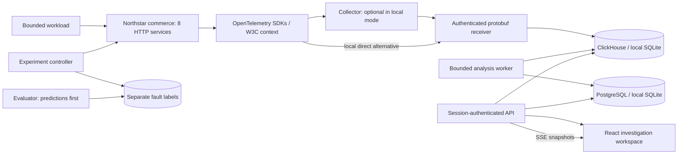

# CausalScope

**From symptoms to evidence.** A local distributed incident investigation platform built around captured OpenTelemetry observations, explicit uncertainty, and repeatable synthetic experiments.

The application is implemented, runnable, and tested locally. This is an engineering edition, **not a claim of production readiness or completion of every enterprise feature in the original brief**. See [completion report](docs/COMPLETION_REPORT.md) and [capability boundaries](docs/LIMITATIONS.md).

## Start locally — Windows / PowerShell

Requires Node.js 24 and pnpm 12. No cloud credentials, Gemini key, Git repository, or Docker is needed for the local mode.

```powershell
pnpm install
pnpm db:generate
Copy-Item .env.example .env
pnpm db:seed
pnpm dev
```

Open **http://localhost:5180/app**. Sign in with `engineer@northstar.local` / `Northstar-local-2026!`. These are explicitly local synthetic credentials. Set `DEMO_EMAIL` and `DEMO_PASSWORD` **before first seed** to create a different initial account. Changing them later does not rewrite an existing user's password.

For optional Gemini summaries, set `GEMINI_ENABLED=true`, `GEMINI_API_KEY`, and
`GEMINI_MODEL=gemini-3.5-flash-lite` in the ignored backend `.env`, then restart
the API. Open an analysis in **Hypotheses** and choose **I consent — explain these
observations**. The model receives only the selected anomaly observations and
returns a summary with checked evidence references. The key stays on the backend.
Model access depends on the Google project.

The local adapter stores metadata and telemetry in `.data/causalscope.sqlite` using Node's SQLite API, WAL, parameterized statements, and composite tenant keys. **Local mode is not PostgreSQL or ClickHouse.** Empty screens are intentional until traffic executes. No prerecorded trace fixture is installed as live data.

`pnpm dev` checks for port conflicts before starting the API, ingestion receiver, analysis worker, eight commerce listeners, and Vite. Stop with Ctrl+C. It does not terminate other projects using occupied ports. Reserved ports: API **4400**, web **5180**, demo **4100–4107**, ingest **4319**; optional Collector **4318**, Collector health **13133**. PostgreSQL **5432** and ClickHouse **8123** are only needed for full storage mode.

## The first reproducible investigation

1. Open **Failure laboratory**, keep healthy checkout, seed 42, 8 req/s, duration 20 seconds. Click **Run experiment**. Watch real traces appear.
2. Select **Database pool exhaustion**, inventory, 400 ms, the same seed/rate/workload, duration 15 seconds. Run it.
3. Open the completed run's **analysis**. Inspect database wait observations, anomalies, service ranking, and supporting trace IDs.
4. Follow a referenced trace. Inspect server/client relationships, a bounded pool wait, exceptions, linked spans, structural ordering, and correlated logs.
5. Open an incident, add a note, move its status, replay persisted windows, and export Markdown or JSON.
6. Run **Counterfactual lab** for an automatically reset healthy/fault pair. Review a measured comparison; repeat to study variability.

Inventory ranking first is an observed experimental outcome, not a guaranteed result or proof of a production cause. All ten fault mechanisms have live verification coverage; ranking misses remain visible in evaluations.

## Real Collector path

Default local mode sends genuine SDK OTLP/HTTP **protobuf** directly to the receiver. To include a Collector, install the official OpenTelemetry Collector and use `infrastructure/collector/local.yaml`:

```powershell
# Terminal 1 — point to your installed collector binary
$env:INGEST_TOKEN = 'local-synthetic-ingest-token-replace'
& 'C:\path\to\otelcol.exe' --config=infrastructure/collector/local.yaml

# Terminal 2 — start CausalScope with export through the Collector
$env:OTEL_EXPORTER_OTLP_ENDPOINT = 'http://127.0.0.1:4318'
pnpm dev
```

Collector **0.163.1** was actually run during verification on this Windows host. The receiver supports gzip and uncompressed protobuf traces using vendored official OpenTelemetry proto **v1.9.0** definitions. It does not implement OTLP logs, OTLP metrics, gRPC, or JSON OTLP. Structured correlated logs use a separate authenticated internal JSON endpoint.

## Full infrastructure

```powershell
docker compose up --build -d
```

Compose includes PostgreSQL, ClickHouse initialization, migration job, Collector, ingest, analyzer, commerce process, and the API serving the built frontend at **http://localhost:4400**. Infrastructure admin ports bind to loopback; receiver, Collector, and commerce listeners are not published. No external deployment is performed.

**Docker was unavailable on the implementation host.** Compose, PostgreSQL migrations against a server, and the ClickHouse adapter are prepared but not runtime-verified here. The metadata schema uses Prisma composite-key JSONB records rather than a fully normalized enterprise domain schema. See [deployment guidance](docs/deployment/README.md) before using real infrastructure.

## What runs



- React 19, Vite 8, strict TypeScript, TanStack Query, React Router, Motion, custom SVG, monochrome CSS, Lucide.
- Express 5, Zod, Argon2id, opaque hashed server-side sessions, HttpOnly/SameSite cookies, CSRF, roles and scoped authorization.
- OpenTelemetry tracing SDK 2.12 / protobuf exporter 0.223, ClickHouse client, Prisma 6.19.3 (deliberately pinned stable rather than the registry's Prisma 8 release candidate).
- BFS/DFS, SCCs, condensation DAG, bounded paths, interval unions, structural event constraints, percentiles, MAD/EWMA/CUSUM, deterministic evidence-aware ranking and metric baseline.
- Persisted incidents, notes, lifecycle, window replay, safe fault controller, same-workload pairs, evaluated rankings, deterministic reports and optional consent-gated Gemini summaries.

UI views: operational overview, service map, traces/waterfall, metrics, structured logs, incidents, replay, hypotheses, failure lab, paired experiments, evaluation, analytics, instrumentation, and runtime settings. State comes from API/storage, not a dashboard fixture.

## Verify

```powershell
pnpm build
pnpm test
pnpm exec playwright install chromium
pnpm test:e2e
# With the application running:
pnpm verify:live --all
pnpm benchmark
```

The live suite performs requests, waits for actual export, checks persisted spans and context relationships, checks fault evidence, stops a running experiment, verifies reset, and reads an SSE update. Allow roughly three minutes for the full workload sequence. Benchmark inputs explicitly distinguish generated 8/25/100-service graphs from the **eight actual HTTP services**. Results include environment details and measured quantiles. They are not enterprise throughput claims.

Actual output files are in `artifacts/`: live verification and benchmark JSON. Browser checks produce screenshots for 1440, 1024, 768, and 390 px. The small-screen topology uses an accessible dependency list. `playwright-report/index.html` is generated by the browser suite.

## Documentation

- [Architecture](ARCHITECTURE.md), [algorithms](ALGORITHMS.md), [decisions](ENGINEERING_DECISIONS.md), [interview guide](INTERVIEW_GUIDE.md).
- [Ingestion contract](docs/INGESTION.md), [security](docs/SECURITY.md), [experiments](docs/experiments/README.md), [benchmark methodology](docs/benchmarks/README.md).
- [API reference](docs/API.md), authenticated `/api/v1/openapi` for the implemented basic OpenAPI index.
- [Limitations and unfinished requirements](docs/LIMITATIONS.md), [verification report](docs/COMPLETION_REPORT.md).

Dependency behavior was checked against package metadata and the official [OpenTelemetry exporter documentation](https://opentelemetry.io/docs/languages/js/exporters/), [proto definitions](https://github.com/open-telemetry/opentelemetry-proto/tree/v1.9.0), [Collector releases](https://github.com/open-telemetry/opentelemetry-collector-releases/releases/tag/v0.163.1), and [ClickHouse deduplication guidance](https://clickhouse.com/docs/engines/table-engines/mergetree-family/replacingmergetree). The lockfile records the actual resolved dependency versions.
# casualScope_cv

